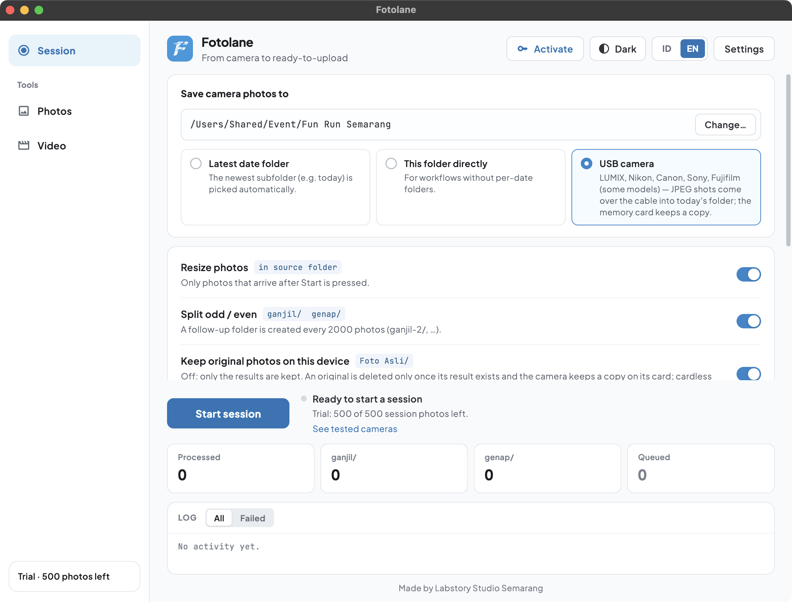
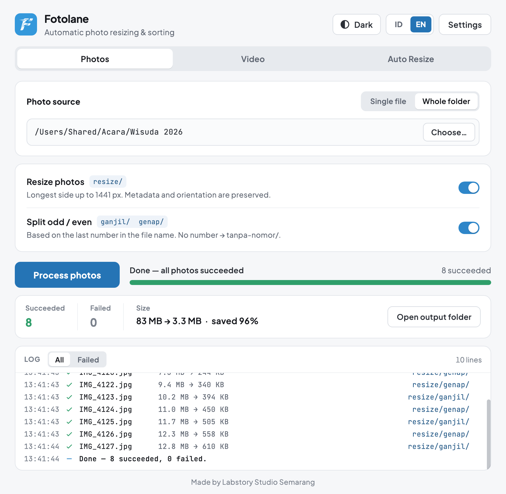
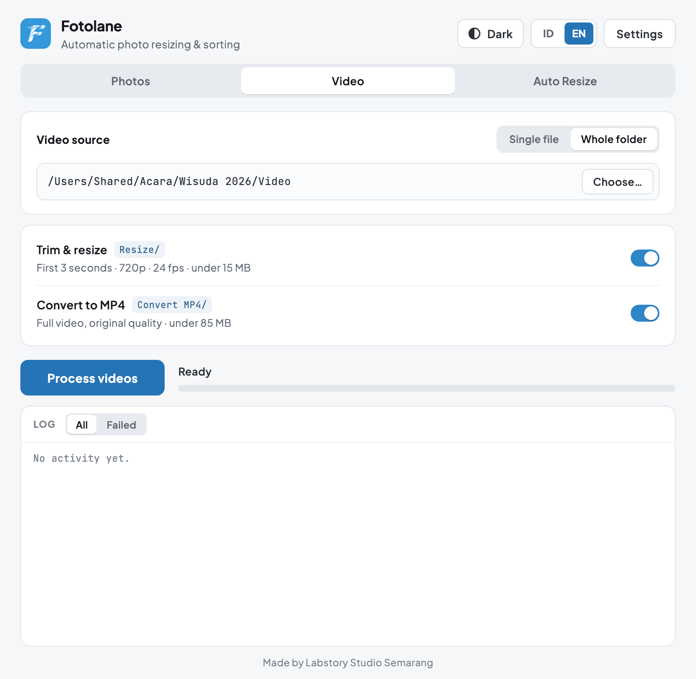

<div align="center">


# Fotolane

**Automatic event photo prep** — by Labstory Studio

Thousands of event photos, upload-ready without babysitting.

Android · macOS · Windows

[Instagram @labstory.studio](https://www.instagram.com/labstory.studio/)

[Baca dalam Bahasa Indonesia](README.md)

</div>

---

Straight out of the camera, event photos run tens of megabytes each — too big to
upload, and they have to be split into batches of 2000 per folder. Doing that by
hand after a shoot can eat hours.

Fotolane does it for you. **1000 photos that used to take about 28 minutes are
done in about 41 seconds** (measured on an Apple Silicon Mac; still far faster
than manual work on phones and Windows).

Your original photos are **never modified or deleted**: results always go into
a new folder beside them. The only exception is the USB camera option "Keep
original photos" when you switch it off yourself (see below).

---

## 1. Auto Resize — runs by itself during the event



Pick a folder, press **Start watching**, and leave it alone. Every new photo that lands
is resized and sorted into `ganjil` (odd) and `genap` (even) folders.

- Watch **today's date folder** inside the folder you picked, or **the folder
  itself**.
- After **2000 photos**, the next folder is created automatically: `ganjil-2`,
  `ganjil-3`, and so on.
- Only photos that **arrive after you press Start** are processed. Anything
  already sitting in the folder is skipped.
- Photos still being copied from the camera are **waited on until the copy
  finishes**, so nothing is processed half-written.
- **The screen can be off** — processing keeps running.

### USB camera — straight from the camera

Choose the **USB camera** source, connect the camera with a cable, press **Start
watching**, and shoot as usual. Every shot comes in over the cable, is resized, and is
split into `ganjil` / `genap`.

- Originals go into a `Foto Asli` folder; the results go into today's date
  folder, which switches by itself at midnight.
- File names follow the camera's numbering, and the memory card keeps a copy
  (when the camera saves to its card).
- Only JPEG is taken; RAW stays on the card. Sony over PC Remote: set "RAW+J
  PC Save Image" to JPEG only (if the menu has it), otherwise the RAW also
  crosses the cable and is dropped.
- Cable pulled? Fotolane reconnects by itself, and shots taken while it was
  out are picked up too. The exceptions are Fujifilm and Sony over PC Remote:
  those shots are not picked up, and are only on the card if the camera saves
  to its card.
- **Keep original photos on this device**: switch it off to keep only the
  results (in `ganjil` / `genap`). An original is deleted only once its result
  exists **and** the camera keeps a copy on its card. Cardless shots
  (PC000001…) and photos that fail to process are never deleted.
- **macOS:** LUMIX, Canon, Nikon, Sony, Fujifilm (older Sony bodies such as
  the a7 III, a9, a6000–a6600 over PC Remote mode).
  **Windows:** LUMIX, Canon, Nikon, Sony (PC Remote mode), Fujifilm.
  Fotolane installs no drivers.
  **Android:** LUMIX, Canon, Nikon, Sony (PC Remote mode), with a short USB-C
  cable (1 m at most).
- Models tested with a real camera: see the list below.
- Press **Stop** before unplugging the cable.

### Tested cameras

| Brand | Model | macOS | Windows | Android |
|---|---|:---:|:---:|:---:|
| LUMIX | S5IIX (DC-S5M2X) | ✅ | ✅ | ✅ |
| Canon | EOS R50 V | ✅ | ✅ | ✅ |
| Nikon | not yet tested with a real camera | | | |
| Sony | not yet tested with a real camera | | | |
| Fujifilm | not yet tested with a real camera | | | not supported yet |

Your camera isn't listed? It most likely still works, because each brand
uses the same protocol. **Try it during the trial (500 photos)** before you
buy. Once your camera connects, tap **Camera working? Let us know** under the
Auto Resize status and we'll add it to this list. If it won't connect, tap
**Camera not connecting? Let us know**.

## 2. Photos — process a batch at once



For photos you have already collected. Pick one file or one folder, press
**Process photos**, done. Odd/even splitting is available here too.

When it finishes, a summary shows how many photos succeeded and how much space
was saved. If any file failed (a corrupt one, say), just press **Retry** —
only that file is processed again.

## 3. Video



- **Trim & shrink** — take the first few seconds, guaranteed under a size limit
  (default: 3 seconds, 720p, under 15 MB).
- **Convert to MP4** — the whole video, original quality kept, under 85 MB.

## Small things that help

- **Drag & drop** files or folders straight onto the app window (Mac &
  Windows).
- **A notification when it's done**, with sound — both can be turned off in
  Settings.
- **Dark mode** and a choice of **Indonesian / English**, right at the top of
  the screen.

---

## What the output looks like

With **Auto Resize**, results are written inside the source folder:

```
Event Folder/
└── 2026-09-23/              ← date folder, picked automatically
    ├── DSC_0011.jpg         ← original, untouched
    ├── DSC_0012.jpg
    ├── ganjil/              ← max 2000 photos ("odd")
    │   ├── DSC_0011.jpg
    │   └── DSC_0013.jpg
    ├── ganjil-2/            ← created automatically when "ganjil" fills up
    └── genap/               ← "even"
        ├── DSC_0012.jpg
        └── DSC_0014.jpg
```

With the **Photos** tab, results go into a `resize/` folder beside the source:

```
Photo Folder/
├── DSC_0011.jpg
└── resize/
    ├── ganjil/
    └── genap/
```

Odd or even is decided by the **last number in the file name**, not by position
in the folder — so results don't shift when the folder grows.

---

## Download

Grab the newest version from the **[Releases page](../../releases/latest)**,
then pick the one file for your device:

| Device | File to download | Requires |
|---|---|---|
| **Android** phone / tablet | `Fotolane-…-arm64.apk` | Android 7.0+, 64-bit |
| **Mac** | `Fotolane-….dmg` | macOS 12+ |
| **Windows** | `Fotolane-Setup-….exe` | Windows 10 / 11, 64-bit |

### Install notes

**Android** — since this doesn't come from the Play Store, Android will ask once
whether to allow installing from this source; allow it. On first use the app
asks for **"All files access"**. That permission is used to read your photo
folder and write the results folder next to it — without it the app cannot save
results where you chose. The app sends nothing anywhere.

**Mac** — if macOS says the app can't be opened, right-click the app icon and
choose **Open**.

**Windows** — if the blue SmartScreen appears, click **More info → Run anyway**.

---

## Pricing

| | |
|---|---|
| **Photos** & **Video** tabs | Free forever |
| **Auto Resize** | Free for the **first 500 photos** |
| Full license | **Rp 400,000, one-time**, for **2 devices** (e.g. a laptop + a phone/tablet), including **1 year of updates** |
| Update renewal | **Rp 150,000 per year**, optional. Without it, the version you have keeps working forever |

Using a USB camera? Try it with your camera during the trial before you buy
(see [tested cameras](#tested-cameras)).

How to buy, all from inside the app:

1. Press **Activate** at the top of the screen.
2. Pay with **QRIS** (merchant *LABSTORY - SMRG*) using the amount shown —
   the last three digits identify your payment.
3. Press **Send via WhatsApp**. The message is already filled in.
   No WhatsApp on that device? Scan the *"Send from your phone"* QR with your
   phone camera, or email **labstoryid@gmail.com** instead. We reply with the
   key the same way.
4. We reply with a key. Paste it into the app and press **Activate** — done.

For a second device, open **Activate** on that device and tap *"Already
bought? Request a key for this device"*.

A license covers every version released up to one year after you buy. Before
offering an update outside that window, the app tells you first. Renew from
**Settings → Renew updates**; one payment renews both of your devices.
Licenses bought before 13 October 2026 keep getting every update.

---

## Automatic updates

Install once. The app checks for new versions on its own and offers them in a
dialog — one click to download. You won't need to come back to this page.

---

## Frequently asked

**Are my original photos safe?**
Yes. The app only reads the originals and writes results into a new folder.
Nothing is overwritten or deleted.

**How small do the results get?**
By default the longest side becomes 1441 pixels at quality 92 — camera photos
usually land in the few-hundred-kilobyte range. You can change this in **Settings**.

**Some photos came out the same size. Why?**
Those were already smaller than the limit. The app never enlarges photos, and
re-encoding them could actually make the file bigger — so they are copied as-is.

**Which formats are supported?**
JPG, JPEG, PNG, WebP, BMP and TIFF. **HEIC is not supported** — if your camera
or iPhone saves HEIC, switch it to JPEG first.

**Is photo metadata lost?**
No. Camera information and photo orientation are preserved.

**Does it need internet?**
No. Everything is processed on your own device. Internet is only used to check
for updates.

**Does Auto Resize drain the battery?**
While watching, the app keeps the processor awake so work doesn't stop when the
screen turns off — roughly a few percent of battery per day. What really drains
the battery is leaving the screen on, which is why that option is off by
default.

---

<div align="center">

Made by **Labstory Studio Semarang**

[Instagram @labstory.studio](https://www.instagram.com/labstory.studio/)

<sub>This app is built independently by a fellow photographer and is not
affiliated with, or officially endorsed by, any platform.</sub>

</div>
