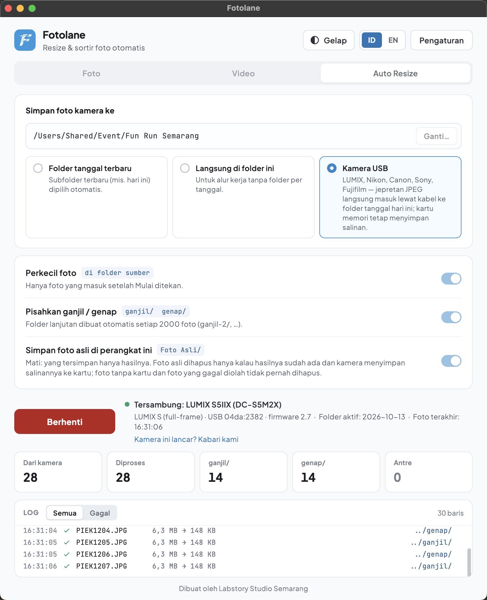

<div align="center">


# Fotolane

**Penyiap foto acara otomatis** — oleh Labstory Studio

Ribuan foto acara siap unggah tanpa perlu ditunggui.

Android · macOS · Windows

[Instagram @labstory.studio](https://www.instagram.com/labstory.studio/)

</div>

---

Foto langsung dari kamera ukurannya puluhan MB — terlalu besar untuk diunggah,
dan harus dipecah per 2000 foto per folder. Mengerjakannya manual setelah acara
bisa memakan berjam-jam.

Fotolane mengerjakan itu sendiri: **1000 foto diperkecil dalam sekitar 41
detik** (±41 ms per foto, diukur di Mac Apple Silicon; di HP dan laptop
Windows lebih lambat, tergantung perangkatnya).

Foto aslimu **tidak pernah diubah atau dihapus**: hasilnya selalu ditulis ke
folder baru di sampingnya. Satu-satunya pengecualian adalah opsi Kamera USB
"Simpan foto asli" kalau kamu matikan sendiri (lihat di bawah).

---

## 1. Sesi — jalan sendiri selama acara


Pilih sumber dan folder tujuan, tekan **Mulai sesi**, lalu biarkan. Setiap foto
baru langsung diperkecil dan dipisah ke folder `ganjil` dan `genap`.

- Tiga sumber: **Kartu SD**, **Kamera USB**, atau **Folder terpilih** (folder
  yang kamu isi sendiri).
- **Kartu SD** (Mac, Windows, Android lewat card reader USB-C): selama sesi
  berjalan, setiap kartu yang dicolok disalin foto **hari ini**-nya, lalu
  dikompres. Tiap kartu punya foldernya sendiri (`Kartu SD 1`, `Kartu SD 2`,
  …), jadi nomor foto yang sama dari kartu lain tidak bertabrakan. Kartu yang
  sama dicolok lagi kembali ke foldernya tanpa foto dobel; kartu yang sudah
  diformat dapat folder baru. Setelah selesai muncul "boleh dicabut". Kartu
  tidak pernah diubah atau dihapus. Cocok untuk burst tinggi: kamera memotret
  tanpa kabel dengan kecepatan penuh, kartu dimasukkan saat jeda.
- Hasil dibagi ke `ganjil 1`, `ganjil 2`, `ganjil 3` (dan `genap` yang sama),
  maksimal 2000 foto per folder. Isinya ditentukan **nomor foto kamera**:
  folder 1 untuk nomor 0001–3999, folder 2 untuk 4000–7999, folder 3 untuk
  8000–9999. Jadi foto yang disusulkan belakangan (misalnya setelah kabel
  sempat lepas) tetap masuk foldernya sendiri, dan folder yang sudah
  diunggah tidak berubah. Foto tanpa nomor kamera (mis. nama berformat jam)
  dibagi per 2000 menurut urutan datang.
- Hanya foto yang **masuk setelah tombol Mulai ditekan** yang diproses. Foto
  lama yang sudah ada di folder itu dilewati.
- Foto yang masih separuh tersalin dari kamera **ditunggu sampai selesai**,
  jadi tidak ada hasil yang rusak setengah jadi.
- **Layar boleh dimatikan** — prosesnya tetap jalan.

### Kamera USB — langsung dari kamera



*Sesi nyata dengan LUMIX S5IIX: setiap jepretan masuk lewat kabel, 6,3 MB
menjadi 148 KB, lalu terpilah ganjil / genap.*

Pilih sumber **Kamera USB**, colok kamera dengan kabel, tekan **Mulai sesi**, lalu
memotret seperti biasa. Setiap jepretan langsung masuk lewat kabel, diperkecil,
dan dipisah ke `ganjil` / `genap`.

- Foto asli disimpan di folder `Foto Asli`; hasilnya di folder tanggal hari
  ini, yang berganti sendiri lewat tengah malam.
- Nama file mengikuti nomor kamera, dan kartu memori tetap menyimpan salinan
  (kalau kamera menyimpan ke kartu).
- Hanya JPEG yang diambil; RAW tetap di kartu. Sony lewat PC Remote: atur
  "RAW+J PC Save Image" ke JPEG saja (kalau ada di menunya), kalau tidak
  RAW ikut terkirim lewat kabel lalu dibuang.
- Kabel tercabut? Fotolane menyambung lagi sendiri, dan foto yang dijepret
  selagi kabel lepas ikut diambil dari kartu. Ini sudah dicoba dengan kamera
  asli untuk LUMIX dan Canon; Nikon memakai cara yang sama tapi belum diuji.
  Fujifilm, dan Sony kecuali beberapa model baru di macOS, tidak mengambil
  foto yang dijepret selagi kabel lepas: foto itu hanya ada di kartu kalau
  kamera menyimpan ke kartu.
- Opsi **Simpan foto asli di perangkat ini**: matikan bila yang ingin
  disimpan hanya hasilnya (di `ganjil` / `genap`). Foto asli dihapus hanya
  kalau hasilnya sudah ada **dan** kamera menyimpan salinannya ke kartu.
  Foto tanpa kartu (PC000001…) dan foto yang gagal diolah tidak pernah
  dihapus.
- **macOS:** LUMIX, Canon, Nikon, Sony, Fujifilm (Sony lama seperti a7 III,
  a9, a6000–a6600 lewat mode PC Remote).
  **Windows:** LUMIX, Canon, Nikon, Sony (mode PC Remote), Fujifilm.
  Fotolane tidak memasang driver apa pun.
  **Android:** LUMIX, Canon, Nikon, Sony (mode PC Remote), dengan kabel USB-C
  pendek (maksimal 1 m).
- Fujifilm hanya untuk model yang didukung SDK Fujifilm: X-H2, X-H2S, X-T5, X-T4, X-T3, X-S20, X-S10, X-M5, X-Pro3, dan GFX (100 II, 100S II, 100S, 100, 100RF, 50S II, 50S, 50R, ETERNA 55). Model lain
  (mis. seri X100, X-E, X-T30) tidak ada di daftar SDK, jadi belum didukung.
- Merek lain (OM System / Olympus, Pentax / Ricoh, Leica, Sigma) belum bisa
  lewat kabel. Pakai Sesi dengan folder kartu memori.
- Model yang sudah diuji dengan kamera asli: lihat daftar di bawah.
- **Burst panjang:** saat tersambung kabel, kamera mengosongkan buffer lebih
  lambat (LUMIX S5IIX: ±2× lebih lama, ini perilaku kamera sendiri). Untuk
  burst tinggi, pakai sumber **Kartu SD**. Foto yang belum terkirim tetap
  diambil dari kartu begitu kamera senggang dan tampil di baris
  "Tertinggal", juga setelah sesi dihentikan lalu dimulai lagi di hari yang
  sama.
- Tekan **Hentikan sesi** sebelum mencabut kabel.
- **Sambungan sering putus?** Cabut lalu colok ulang kabel dengan mantap (di
  kamera dan di laptop/tablet/hub), coba port lain atau tanpa hub, atau ganti
  kabel. Kalau tetap gagal, matikan kamera, cabut-pasang baterai, lalu
  nyalakan lagi. Fotolane juga menampilkan petunjuk ini saat sambungannya
  tersendat.

### Kamera yang sudah diuji

| Merek | Model | macOS | Windows | Android |
|---|---|:---:|:---:|:---:|
| LUMIX | S5IIX (DC-S5M2X) | ✅ | ✅ | ✅ |
| Canon | EOS R50 V | ✅ | ✅ | ✅ |
| Nikon | belum diuji dengan kamera asli | | | |
| Sony | belum diuji dengan kamera asli | | | |
| Fujifilm | belum diuji dengan kamera asli | | | belum didukung |

Kameramu belum ada di daftar? Model LUMIX, Canon, dan Nikon lain kemungkinan
besar jalan karena satu merek memakai protokol yang sama, tapi belum
dijamin. Sony dan Fujifilm bergantung pada daftar model SDK pabrikannya (lihat
di atas). **Coba dulu selama masa coba (500 foto)** sebelum membeli. Setelah kameramu tersambung, tekan
**Kamera ini lancar? Kabari kami** di bawah status Sesi, dan kameramu
kami tambahkan ke daftar ini. Kalau tidak mau tersambung, tekan **Kamera
tidak tersambung? Kabari kami**.

## 2. Foto — proses sekaligus


Untuk foto yang sudah terkumpul. Pilih satu file atau satu folder, tekan
**Proses foto**, selesai. Pemisahan ganjil/genap juga tersedia di sini, dan
hasilnya juga dipecah per 2000 foto per folder.

Setelah selesai, ringkasan menunjukkan berapa foto yang berhasil dan berapa
ruang yang dihemat. Kalau ada file yang gagal (misalnya rusak), cukup tekan
**Coba lagi** — hanya file itu yang diproses ulang.

## 3. Video


- **Potong & perkecil** — ambil beberapa detik pertama, dijamin di bawah batas
  ukuran (bawaan: 3 detik, 720p, di bawah 15 MB).
- **Ubah ke MP4** — video utuh, kualitas asli dipertahankan, di bawah 85 MB.

## Hal kecil yang memudahkan

- **Seret & lepas** file atau folder langsung ke jendela app (Mac & Windows).
- **Notifikasi saat selesai**, lengkap dengan suara — bisa dimatikan di
  Pengaturan.
- **Mode gelap** dan pilihan **bahasa Indonesia / English**, langsung dari
  bagian atas layar.
- **Ukuran tampilan 80–125%** di Pengaturan (atau ⌘/Ctrl + / − / 0) untuk
  layar laptop yang pendek, dan menu samping yang bisa disembunyikan (Mac &
  Windows).

---

## Struktur folder hasil

Dengan **Sesi**, hasil ditulis di folder tanggal hari ini. Sumber **Kartu SD**:

```
Folder Acara/
└── 2026-10-20/              ← folder tanggal (dibuat otomatis)
    ├── Kartu SD 1/
    │   ├── Foto Asli/       ← salinan utuh dari kartu
    │   ├── ganjil 1/        ← nomor foto 0001–3999: maks 2000 foto
    │   ├── genap 1/
    │   └── ganjil 2/        ← nomor 4000–7999
    └── Kartu SD 2/          ← kartu berikutnya (kamera lain / kartu diformat)
        ├── Foto Asli/
        ├── ganjil 1/
        └── genap 1/
```

Sumber **Kamera USB**: `Foto Asli`, `ganjil 1`, `genap 1`, … langsung di
folder tanggal. Sumber **Folder terpilih**: `ganjil 1`, `genap 1`, … di
dalam folder itu.

Dengan tab **Foto**, hasil masuk ke folder `resize/` di samping foto sumber:

```
Folder Foto/
├── DSC_0011.jpg
└── resize/
    ├── ganjil/              ← maks 2000 foto, lalu ganjil-2, ganjil-3, …
    └── genap/
```

Ganjil atau genap ditentukan dari **angka terakhir pada nama file**, bukan dari
urutan. Jadi hasilnya tidak berubah walau isi folder bertambah.

---

## Unduh

Ambil versi terbaru di **[halaman Releases](../../releases/latest)**, lalu
pilih satu berkas sesuai perangkatmu:

| Perangkat | Berkas yang diunduh | Syarat |
|---|---|---|
| HP / tablet **Android** | `Fotolane-…-arm64.apk` | Android 7.0 ke atas, 64-bit |
| **Mac** | `Fotolane-….dmg` | macOS 12 ke atas, **Apple Silicon** (M1 atau lebih baru) |
| **Windows** | `Fotolane-Setup-….exe` | Windows 10 / 11, 64-bit (prosesor Intel / AMD) |

### Persyaratan

Cek dulu sebelum membeli; masa coba 500 foto bisa dipakai untuk memastikan
semuanya jalan di perangkatmu.

- **Mac Intel belum didukung.** Kompresi foto/video dan kamera USB di
  Fotolane untuk Mac saat ini hanya jalan di Mac Apple Silicon (M1, M2, M3,
  M4, dan seterusnya). Cek di menu Apple → *About This Mac*: tertulis
  "Chip Apple M…", bukan "Processor Intel".
- **Prosesor & RAM (laptop / PC):** disarankan 4 core dan RAM 8 GB.
  Laptop 2 core (mis. Intel Celeron / Pentium, AMD Athlon) tetap bisa
  dipakai tapi lebih lambat; Fotolane otomatis memproses lebih sedikit foto
  sekaligus di laptop seperti itu.
- **Ruang penyimpanan:** sekitar 1 GB untuk app, ditambah ruang untuk foto.
  Foto asli ikut disimpan kecuali opsi *Simpan foto asli di perangkat ini*
  dimatikan (hasil kompresi hanya ±2% dari ukuran aslinya).
- **Android:** Android 7.0 ke atas, 64-bit (hampir semua HP / tablet sejak
  2017). Untuk kamera USB, perangkat harus mendukung USB OTG; pakai kabel
  USB-C data, maksimal 1 m.
- **Kamera USB:** pakai kabel data (bukan kabel khusus mengisi daya), matikan
  Wi-Fi kamera, dan cek [daftar kamera yang sudah diuji](#kamera-yang-sudah-diuji).

### Catatan pemasangan

**Android** — karena tidak lewat Play Store, Android akan bertanya sekali soal
"instal dari sumber ini"; izinkan. Saat pertama dipakai, app meminta izin
**"Akses semua file"**. Izin itu dipakai untuk membaca folder fotomu dan
menulis folder hasil di sebelahnya — tanpa itu app tidak bisa menyimpan hasil
di tempat yang kamu pilih. Fotomu tidak pernah dikirim ke mana pun.

**Mac** — Fotolane belum dinotarisasi Apple, jadi saat pertama dibuka macOS
akan menolaknya. Caranya:

1. Seret Fotolane ke folder **Aplikasi**, lalu buka sekali. Saat muncul
   peringatan, tekan **Selesai** (bukan Pindahkan ke Tong Sampah).
2. Buka **Pengaturan Sistem → Privasi & Keamanan**, gulir ke bawah, lalu tekan
   **Tetap Buka** di samping pesan tentang Fotolane. Masukkan kata sandi Mac.
3. Buka Fotolane lagi dan tekan **Buka**. Langkah ini cukup sekali.

Di macOS 14 atau lebih lama, cukup klik kanan ikon app lalu pilih **Buka**.

**Windows** — kalau muncul layar biru SmartScreen, klik **Info selengkapnya →
Tetap jalankan**.

---

## Harga

| | |
|---|---|
| Tab **Foto** & **Video** | Gratis selamanya |
| **Sesi** | Gratis untuk **500 foto pertama** |
| Lisensi penuh | **Rp 400.000, sekali bayar**, untuk **2 perangkat** (mis. laptop + HP/tablet), termasuk **update 1 tahun** |
| Perpanjangan update | **Rp 150.000 per tahun**, opsional. Tanpa perpanjangan, versi yang sudah kamu punya tetap jalan selamanya |

Pakai kamera USB? Coba dulu dengan kameramu selama masa coba sebelum membeli
(lihat [kamera yang sudah diuji](#kamera-yang-sudah-diuji)).

Cara membeli:

1. Tekan **Aktifkan** di bagian atas layar, lalu **Buka halaman beli**.
   Halaman [apps.labstory.id/produk/fotolane](https://apps.labstory.id/produk/fotolane)
   terbuka dengan kode perangkatmu sudah terisi.
2. Bayar dengan **QRIS** di halaman itu.
3. Setelah pembayaran dikonfirmasi, kunci tampil di halaman pembayaran dan
   dikirim ke email-mu.
4. Tempel kunci (atau seluruh isi email kuitansi) di jendela **Aktifkan**,
   lalu tekan **Aktifkan** — selesai.

**Perangkat kedua** gratis: daftarkan kode perangkatnya di halaman
pembayaranmu (tautannya ada di email kuitansi), lalu tempel kunci yang
muncul di perangkat itu. Jangan membeli lagi.

Ada pertanyaan sebelum membeli? Kirim email ke **hello@labstory.id**.

Lisensi berlaku untuk semua versi yang rilis sampai setahun sesudah kamu
membeli. Sebelum menawarkan update ke versi di luar masa itu, app memberi
tahu dulu. Perpanjang dari **Pengaturan → Perpanjang update**: halaman
[perpanjangan di apps.labstory.id](https://apps.labstory.id/produk/fotolane/perpanjang)
terbuka dengan kuncimu sudah terisi. Tempel juga kunci perangkat keduamu
supaya satu pembayaran memperpanjang keduanya. Lisensi yang dibeli sebelum
13 Oktober 2026 tetap mendapat semua update.

---

## Update otomatis

Cukup pasang sekali. App memeriksa sendiri apakah ada versi baru, lalu
menawarkannya lewat kotak di tengah layar — tinggal klik Unduh. Tidak perlu
kembali ke halaman ini lagi.

---

## Pertanyaan yang sering muncul

**Foto asli saya aman?**
Aman. App hanya membaca foto asli dan menulis hasilnya ke folder baru. Tidak
ada yang ditimpa atau dihapus.

**Seberapa kecil hasilnya?**
Bawaannya sisi terpanjang 1441 piksel dengan kualitas 92 — foto kamera biasanya
jadi beberapa ratus KB. Angka ini bisa diubah di **Pengaturan**.

**Ada foto yang ukurannya tidak berubah, kenapa?**
Berarti foto itu sudah lebih kecil dari batas. App tidak pernah memperbesar
foto, dan meng-encode ulang justru bisa membuat berkasnya lebih besar — jadi
foto seperti itu disalin apa adanya.

**Format apa saja yang didukung?**
JPG, JPEG, PNG, WebP, BMP, dan TIFF. **HEIC belum didukung** — kalau kameramu
atau iPhone menyimpan dalam HEIC, ubah dulu setelannya ke JPEG.

**Metadata foto ikut hilang?**
Tidak. Informasi kamera dan orientasi foto tetap terjaga.

**Perlu internet?**
Untuk membeli atau memperpanjang dan mendapatkan kunci, ya (di
apps.labstory.id). Setelah kunci ditempel, Fotolane tidak butuh internet:
foto diproses di perangkatmu sendiri, juga di lokasi acara tanpa sinyal.
Internet dipakai lagi hanya untuk memeriksa pembaruan, dan untuk mengirim
laporan crash kalau kamu setujui.

**Sesi boros baterai?**
Selama mengawasi, app menjaga prosesor tetap aktif supaya tidak berhenti saat
layar mati — perkiraan beberapa persen baterai per hari. Yang jauh lebih boros
adalah layar yang dibiarkan menyala, jadi pilihan itu sengaja dimatikan secara
bawaan.

---

<div align="center">

Dibuat oleh **Labstory Studio Semarang**

[Instagram @labstory.studio](https://www.instagram.com/labstory.studio/)

<sub>Aplikasi ini dibuat mandiri oleh sesama fotografer dan tidak berafiliasi
dengan, atau didukung secara resmi oleh, platform mana pun.</sub>

</div>
